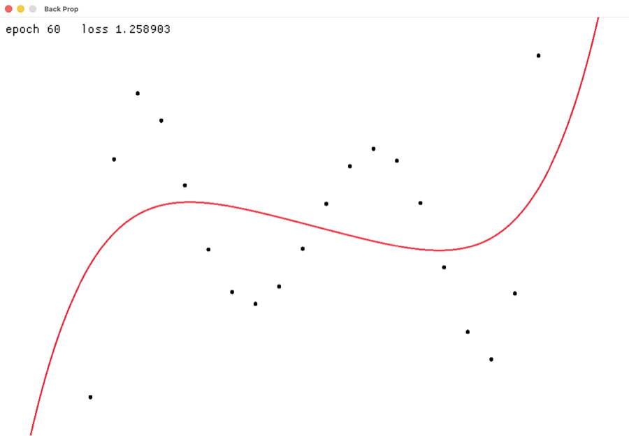
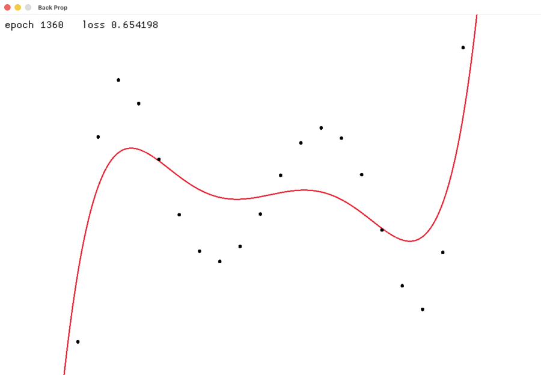
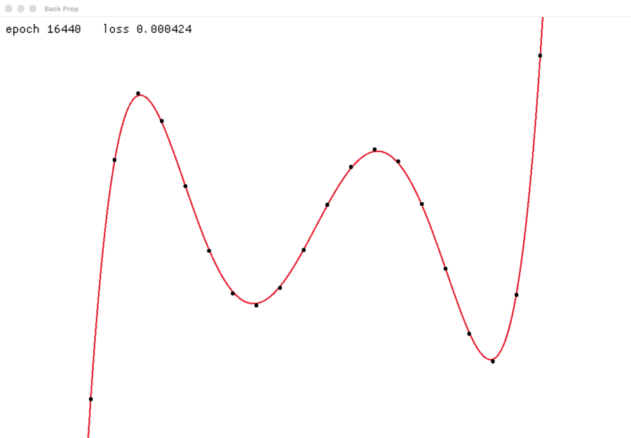
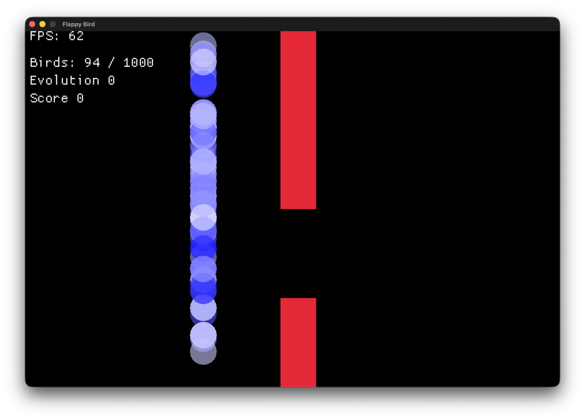
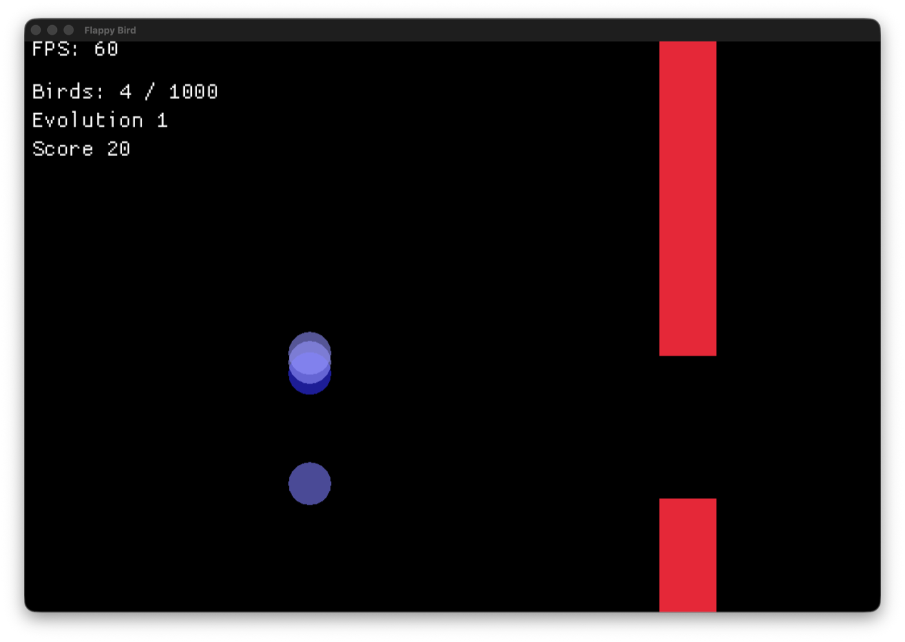

# Machine Learning from Scratch

I'm building a small PyTorch-style deep learning framework in Rust: tensors, automatic differentiation, layers, optimizers, and eventually reinforcement learning agents that play games I wrote myself.

There are no ML crates. No `tch`, no `candle`, no `ndarray`. Everything is built on `Vec<f32>` and math I work out myself.

I don't plan on publishing this. It exists so I can learn Rust and machine learning at the same time.

None of the code in this repository was written by AI. I type all of it myself. That's the point of the project, because code I didn't write is code I didn't learn anything from.

## Where it is

**Working now**

- **Scalar autograd.** A `Value` type backed by a tape, with `+`, `-`, `*`, `pow`, `exp`, `tanh` and `relu`. Calling `backwards()` walks the tape in reverse and fills in every gradient.
- **Gradient checking.** Every op is tested against finite differences, so a wrong derivative fails a test instead of quietly training badly.
- **Polynomial fit.** Gradient descent through the autograd recovers the coefficients of a curve.
- **XOR MLP.** A 2 → 4 → 1 network built from scalar neurons learns XOR, which proves the nonlinearity and backward pass work end to end.
- **Neuroevolution on Flappy Bird.** Birds with tiny networks learn to play through mutation and selection, no gradients involved (more below).

**Coming soon**

- **Tensors.** N-dimensional arrays with shape and strides, so transposes and broadcasts are views rather than copies, plus matmul.
- **Tensor autograd.** Every op gradient-checked, including the tricky parts: summing gradients back through broadcast dimensions and matmul backward.
- **`nn` modules and optimizers.** `Linear`, `Sequential`, SGD and Adam, aiming for 97%+ on MNIST with a 784 → 128 → 10 MLP.
- **Fast matmul.** Loop reordering, cache tiling and `rayon`, with benchmarks for each step.
- **Reinforcement learning.** Q-learning, DQN and REINFORCE, playing the games in this repo.
- **Later.** A CNN, a tiny GPT, and a browser demo.

## Autograd

The core of the framework is reverse-mode automatic differentiation. You build an expression out of `Value`s, call `backwards()`, and every input gets its gradient.

```rust
let a = Value::new(2.0);
let b = Value::new(5.0);
let out = a * b + a;

out.backwards();

assert_close(a.grad(), 6.0, 1e-6); // d(ab + a)/da = b + 1
assert_close(b.grad(), 2.0, 1e-6); // d(ab + a)/db = a
```

The graph lives on a tape: one `Vec` of nodes, and a `Value` is just an index into it. Nodes are stored in the order they were created, so walking the tape backwards is already a valid order for the backward pass, and there are no `Rc<RefCell<...>>` borrow fights.

Every backward rule is checked against finite differences, `(f(x + h) - f(x - h)) / 2h`, so I'm not just trusting my own derivatives.

### Fitting a curve with it

Before autograd I fit a polynomial to some points with gradients I derived by hand. Now the same demo uses autograd: the six coefficients are `Value`s, the loss is an expression, and `backwards()` does the calculus.

| Epoch 60 | Epoch 1,360 | Epoch 16,440 |
| --- | --- | --- |
|  |  |  |
| loss 1.26 | loss 0.65 | loss 0.0004 |

## Neuroevolution on Flappy Bird

This is where the project started, before any gradients. A thousand birds start with random weights and play the same pipes at the same time, and the ones that survive longest get to have children.

Generation 0, where the networks are still random:



Generation 1, after one round of selection and mutation:



Every bird has a `5 → 10 → 1` network. It takes in the bird's height, its velocity, how far away the pipe is, the height of the gap, and the vertical distance between the bird and that gap. If the output comes out above 0 the bird flaps.

Once the last bird dies I sort them by how many frames they survived and keep the top 20 as parents. How many children a parent gets depends on where it ranked. Each parent passes on one exact copy of itself and the rest of its children get mutated.

There's a `bot_mode` flag in [`src/games/flappy.rs`](src/games/flappy.rs). Set it to false and you can play the game yourself with the spacebar. The network and mutation code is in [`src/evo/network.rs`](src/evo/network.rs).

Later this becomes a baseline: the plan is to train a DQN agent on the same game with this framework and compare the two.

## Layout

```
src/
  scalar/     Value, the tape, backward pass, gradient check
  evo/        neuroevolution network
  games/      Flappy Bird and Pong
  testutil.rs assert_close
examples/     one runnable demo per file
models/       saved Flappy Bird weights
assets/       screenshots
```

## Running it

```bash
cargo test
cargo run --release --example polyfit
cargo run --release --example xor
cargo run --release --example flappy
cargo run --release --example pong
```

### Playing Flappy Bird yourself

Flappy Bird starts in bot mode, where a thousand birds are trained by neuroevolution. To play it yourself, open [`src/games/flappy.rs`](src/games/flappy.rs), set `bot_mode` to `false` at the top of `run()`, and run the flappy example again.

| Mode | Controls |
| --- | --- |
| Bot (`bot_mode = true`) | `Enter` kills the current generation and skips to the next. `Esc` prints the best two networks and quits. |
| Play (`bot_mode = false`) | `Space` flaps. `Esc` quits. |

Rust 2024 edition, macroquad for the rendering.
